<div align="center">

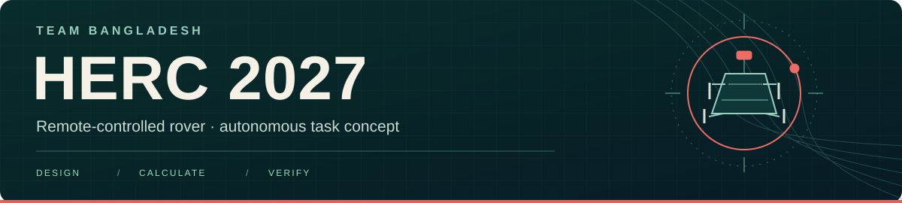

**A private engineering workspace for our NASA Human Exploration Rover Challenge project.**

[Research paper](manuscript/NASA_HERC_Research_Overleaf.pdf) · [Project guide](docs/project-guide.md) · [Design baseline](docs/design-baseline.md) · [Rover figures](cad/figures/README.md) · [Calculations](calculations/README.md) · [Test plan](testing/README.md) · [Open items](docs/open-items.md)

<a href="cad/figures/rover-oblique.jpg">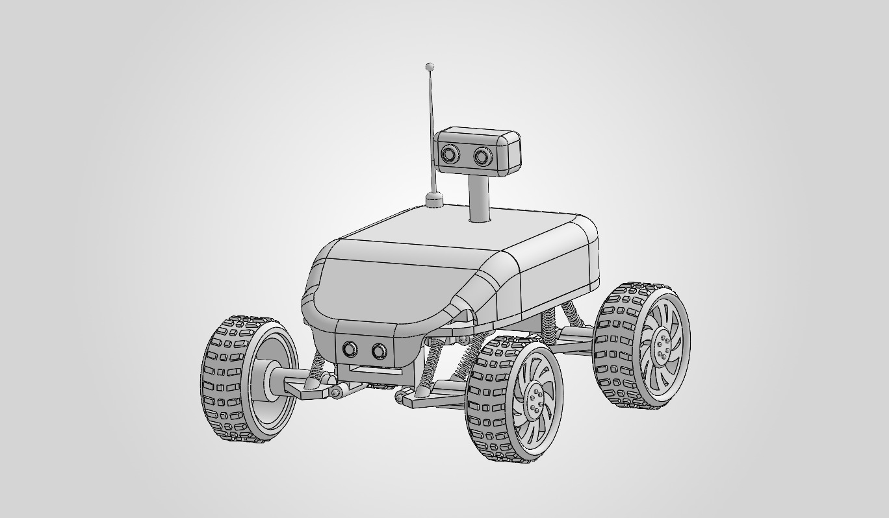</a>

*Our rover design, shown in the supplied three-quarter view. [Explore all eight original figures](cad/figures/README.md).*

</div>

## The project

We are developing a four-wheel rover for the **remote-controlled division of NASA HERC 2027**. The plan combines pilot-controlled mobility with an onboard task system that receives live radio commands, aims the camera, selects an image filter, captures timestamped images, measures target distance, and presents saved results for review.

This repository brings together the mechanical design, electrical architecture, calculations, purchasing references, task illustrations and the evidence needed to test the eventual build. The supplied [research paper (PDF)](manuscript/NASA_HERC_Research_Overleaf.pdf) is included in full. Start with the [complete project guide](docs/project-guide.md) for a connected explanation of every subsystem.

| Included and checked | Current status |
|---|---|
| Calculation code and input validation | **16 tests passed**; reproducible reports included |
| Concept task-scene verification | **17 recorded checks passed** in the supplied historical Blender report |
| Physical acceptance plan | **14 planned tests, all `NOT_RUN`**; measurement templates remain blank |
| Native CAD and rover firmware | Separate CAD bundle is **not included**; deployed control firmware is **not supplied** |

The current aluminium rover's installed mass, finished dimensions and field performance remain unverified. The **10.919 kg** source estimate belongs to an older printed-chassis configuration. Keep it separate from the current design.

## How the rover is intended to work

The pilot drives to the task location. The task system then processes the received sequence without substituting a prerecorded sequence. Drive control and task execution have different hardware and separate batteries.

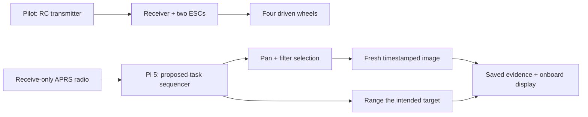

*This is the documented architecture, not a claim that integrated rover-control software has been implemented.*

| Subsystem | Selected design | What it contributes |
|---|---|---|
| Chassis | 6061-T6 aluminium tube and sheet | Structure for the drivetrain and task equipment |
| Wheel modules | Four 215 × 90 mm wheels; PETG rims and TPU 95A tyres | Team-made rolling interfaces, still requiring print and load verification |
| Suspension | Four independent arms, eight springs, four dampers | Planned wheel travel and load support |
| Drive | Four 12 V brushed gearmotors in the 200 RPM class; two side-paired ESCs | Differential left/right drive and steering |
| Manual control | FlySky FS-i6X / FS-iA10B | Pilot commands, mixing and a failsafe that must be tested |
| Task computer | Raspberry Pi 5 with separate task power | Planned command handling, acquisition, logging and display |
| Imaging and pointing | Camera Module 3, pan/filter actuation and control interfaces | Commanded view, filter state and fresh capture |
| Ranging | TF03 sensor with the documented interface | Target distance, with target association and reference correction still to verify |

Read the [controlled design baseline](docs/design-baseline.md) before using an older source drawing. The [drive diagram](diagrams/NASA-HERC-2027-Chassis-Block-Diagram.png), [task power diagram](diagrams/NASA-HERC-2027-Task-Block-Diagram-01.png) and [task flow diagram](diagrams/NASA-HERC-2027-Task-Block-Diagram-02.png) explain the detailed interfaces. They are block diagrams, not complete assembly wiring drawings.

### Task sequence and saved results

The planned command vocabulary is grounded in the [2027 HERC Handbook](https://www.nasa.gov/wp-content/uploads/2026/08/2027-herc-handbook-layout-aug6-508-1.pdf), task section, printed pages 40–42:

| Received code | Intended response |
|---|---|
| `AAA` / `ZZZ` | Open / close the task sequence |
| `B` / `C` | Shift the view 30° right / left |
| `E` / `F` / `G` | Select red / blue / unfiltered imaging |
| `D` | Acquire a new image with its capture time |
| `H` | Obtain distance to the viewed target and record the result in feet |

Filter selection replaces the previous state. Range acquisition should keep the active filter and restore the commanded view after any temporary adjustment. An unavailable measurement must remain explicit. Packet framing, repeated transmissions, cumulative pan range and the RC distance acceptance criterion are tracked as [open engineering items](docs/open-items.md).

## What the numbers mean

All values below are **design inputs or calculations**, not measured rover performance.

| Quantity | Value | Interpretation |
|---|---:|---|
| Proposal footprint | 655 × 630 mm | Planned length and width |
| Height to camera top | 421 mm | Excludes the antenna; not the complete ready-state envelope |
| Concept-model height | About 432 mm | Recorded CAD envelope including model antenna |
| Wheel / rim diameter | 215 / 188 mm | The resulting 13.5 mm radial span is not tyre wall thickness |
| No-slip speed at 200 wheel RPM | 8.105309 km/h | A kinematic scenario; actual limiting requires measurement |
| Team speed target | 8.0 km/h | Verify at full charge and in the planned operating conditions |
| Drive pack | 3S, 5000 mAh; **55.50 nominal Wh** | Separate drive supply |
| Task pack | 3S, 2200 mAh; **24.42 nominal Wh** | Separate task supply |
| Historical source mass | **10.919 kg** | Old CF-PLA body and coupler accounting; not current aluminium-rover mass |

The energy sum is 79.92 nominal Wh, but the batteries do not form a shared supply or establish runtime. The mass work traces **64 historical component rows** and exposes which assumptions need replacement. [Calculation results](calculations/results.md) show the formulas and reconciliation; [inputs](calculations/inputs.json) keep the unverified current mass as `null`.

## Rover design gallery

| Front view | Side profile | Wheel module |
|:---:|:---:|:---:|
| [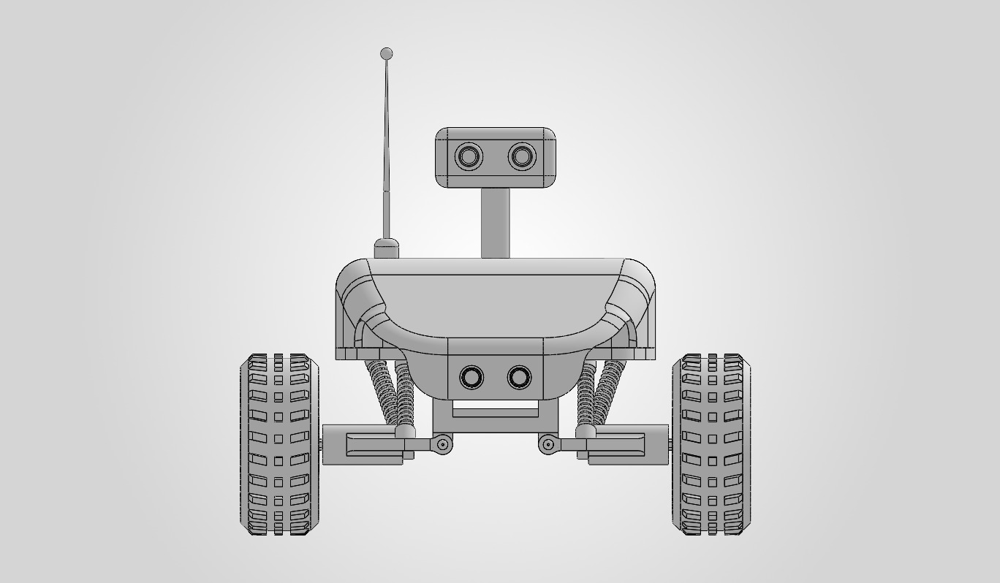](cad/figures/rover-front.jpg) | [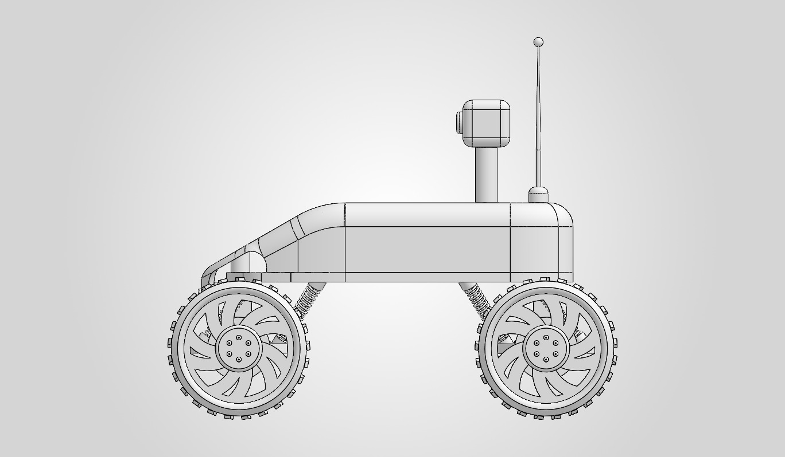](cad/figures/rover-side.jpg) | [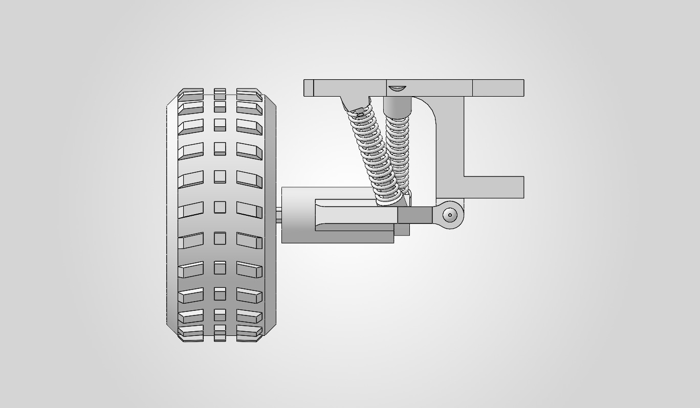](cad/figures/wheel-suspension.jpg) |
| Wheel stance and front layout | Body, camera mast and antenna | Arm, pivot and spring detail |

### Dimensions in the drawings

| Rover width — **630 mm** | Length — **655 mm** · Camera-top height — **421 mm** |
|:---:|:---:|
| [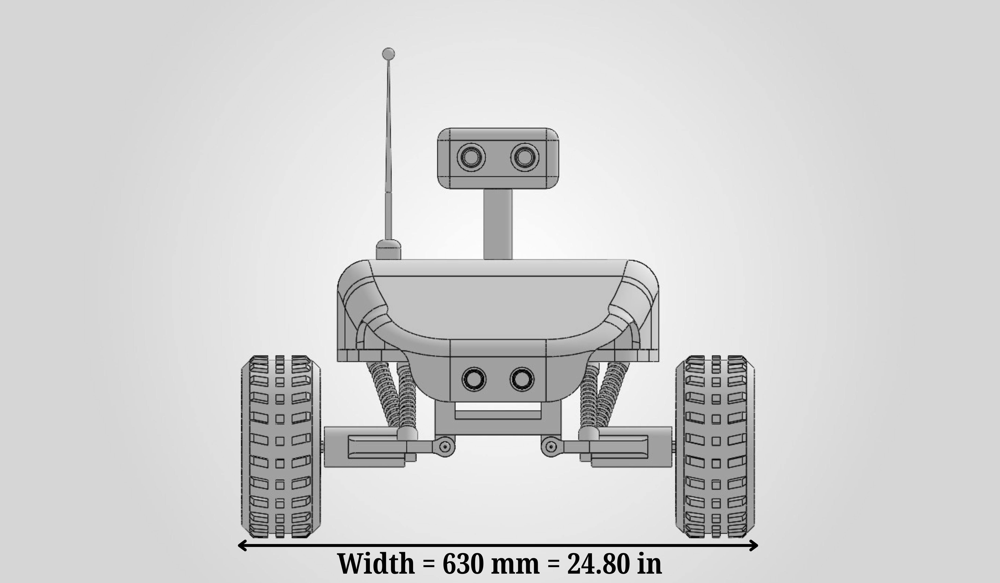](cad/figures/rover-width.png) | [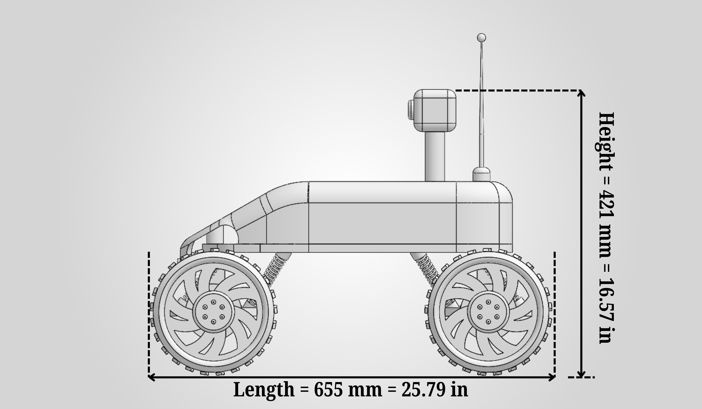](cad/figures/rover-length-height.png) |
| **Wheel width — 90 mm** | **Wheel diameter — 215 mm · Rim diameter — 188 mm** |
| [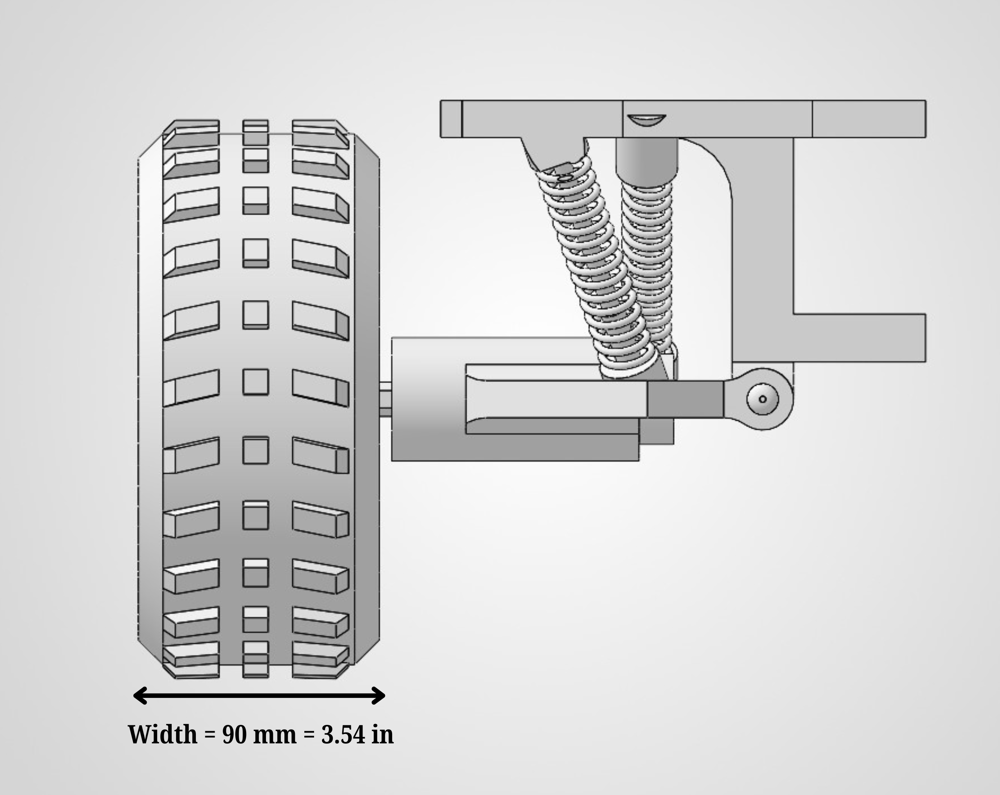](cad/figures/wheel-width.png) | [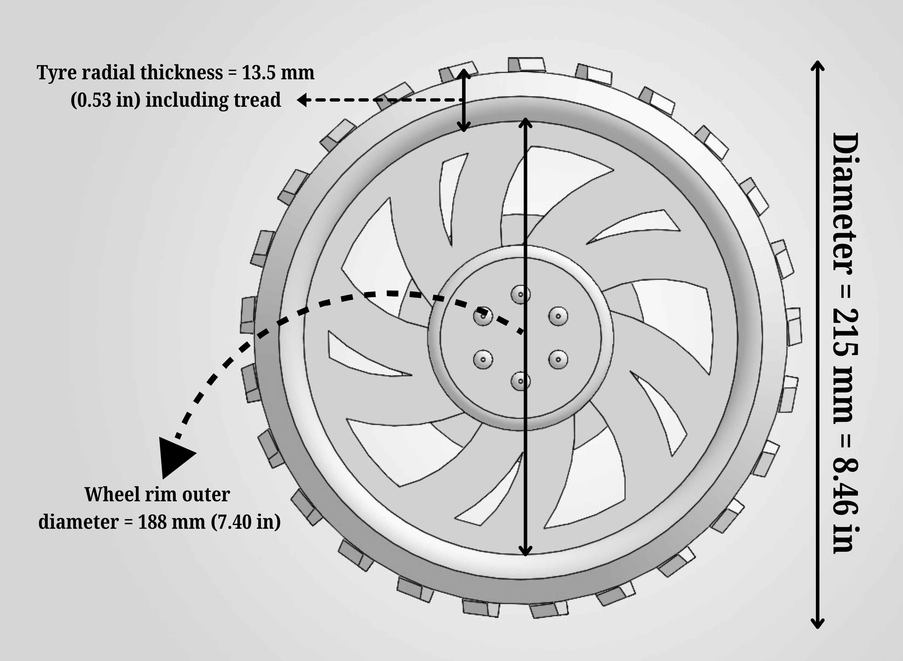](cad/figures/wheel-dimensions.png) |

Select any image for the original full-resolution file. The [figure gallery](cad/figures/README.md) provides individual captions, millimetre/inch values and a source index for all eight images.

The **421 mm height excludes the antenna**. The wheel drawing's **13.5 mm** annotation is the rim-to-tread radial span, **not minimum printed tyre wall thickness**. These are supplied design illustrations; finished dimensions and mechanical performance still need physical verification.

## Run it locally

Use **Python 3.12** to match the GitHub workflow. The calculations and package checks need only the standard library.

```bash
git clone https://github.com/SABIKGIT/nasa-herc-2027.git
cd nasa-herc-2027
python -m unittest discover -s tests -v
python calculations/calculate.py
python tools/verify_package.py
```

Access requires an account permitted to read this **private repository**. The calculator regenerates its three committed reports under `calculations/`; use `--output-dir PATH` to write an independent comparison elsewhere. None of these commands runs motors, receives live radio, or controls the task hardware.

Optional diagram rebuilding uses [requirements-diagrams.txt](requirements-diagrams.txt) and the two `tools/build_*_diagram.py` scripts. See [diagram instructions](diagrams/README.md) for fonts and outputs. A fresh Blender check needs the separately supplied native task model; it is not part of the normal Python workflow.

The [GitHub Actions workflow](https://github.com/SABIKGIT/nasa-herc-2027/actions/workflows/checks.yml) runs the calculation tests, regenerates their reports and checks file integrity and links. See [verification records](docs/verification-record.md) for the scope of recorded evidence.

## Task-scene previews

| Task layout | Example saved results |
|:---:|:---:|
| 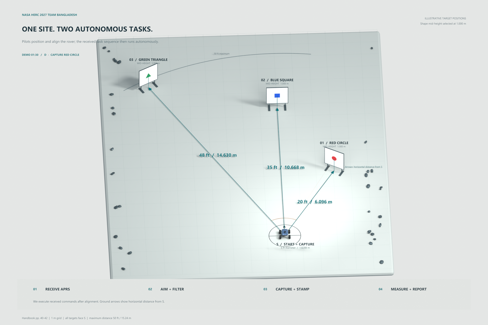 | 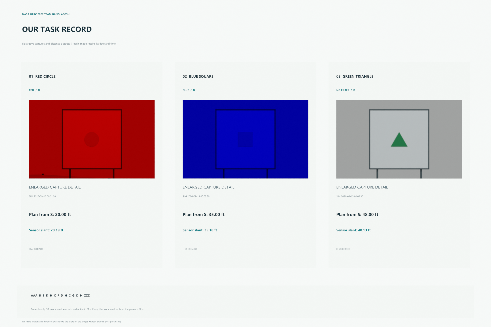 |

The three example targets are placed at **20, 35 and 48 ft** from the start mark. Their sensor slant ranges differ because the sensor is offset and elevated. These are chosen scene coordinates; the rendered capture dates and distances are simulation labels.

<details>
<summary><strong>More previews and architecture diagrams</strong></summary>

- [Target dimensions](cad/previews/02-Target-dimensions.png)
- [Rover image-capture scene](cad/previews/03-Rover-image-capture.png)
- [Distance measurement](cad/previews/04-Distance-measurement.png)
- [Red, blue and unfiltered simulation captures](cad/simulation/)
- [All three subsystem diagrams and their editable sources](diagrams/README.md)
- [Recorded scene measurements](cad/example-scene-measurements.json)

</details>

**CAD availability:** this upload includes previews, measurements, scripts and recorded checks. It does not include the `.blend` or `.stl` files referenced by the separate `NASA-HERC-2027-CAD-Release.zip`. No downloadable CAD release has been created. The [CAD guide](cad/README.md) identifies the expected files and their limitations.

## Turn the design into measured evidence

The [verification matrix](testing/verification-matrix.csv) covers mass/envelope, wheel and suspension behaviour, drive electronics, speed and stopping, task power, radio commands, pointing, imaging, ranging and endurance. All **14 rows start at `NOT_RUN`**; **11 acceptance-criteria entries remain `TBC`**.

For each real test, freeze the build revision, copy the appropriate [blank template](testing/templates/README.md), record the instruments and conditions, collect raw measurements, and link the evidence before assigning a result. Keep unsuccessful attempts and corrective revisions. See [test procedures](testing/test-procedures.md) for the full sequence.

The highest-priority design closures are the aluminium mass budget, supported-spindle assembly, complete antenna-inclusive envelope, actual motor/ESC behaviour, task power reserve, and radio/ranging interpretation. Track them in [open items](docs/open-items.md).

## Planned milestones

| Target | Engineering gate |
|---|---|
| 16 October 2026 | Component ordering |
| 6 November 2026 | Drive and task bench checks |
| 14 November 2026 | Loaded wheel/suspension checks and drawing release |
| 30 January 2027 | Integrated drive/task checks |
| 17 February 2027 | Blocking-fault closure and retesting |
| 20 / 27 February 2027 | Planned ORR upload / three consecutive course-task runs |

These are internal planning dates, not completed tests or independently confirmed NASA deadlines. The final three-run target follows the planned upload; report only evidence actually available at each review. The [full schedule](docs/development-schedule.md) includes handovers and the remaining gates.

## Repository map

| Location | What to read or use |
|---|---|
| `manuscript/` | Supplied NASA HERC research paper (PDF) |
| `docs/project-guide.md` | A complete walkthrough of the project and its data flow |
| `docs/` | Baseline, open decisions, schedule, sources and verification records |
| `docs/source-documents/` | Original technical and purchasing Word snapshots |
| `calculations/` | Executable arithmetic, inputs and generated reports |
| `data/` | Procurement tables, historical mass ledger and source provenance |
| `diagrams/` | Architecture PNGs, editable HTML and layout data |
| `cad/figures/` | Eight original rover views and dimensioned drawings, with captions and provenance |
| `cad/` | Concept previews, simulated captures and scene-check records |
| `testing/` | Procedures, acceptance matrix, open criteria and blank forms |
| `tests/`, `tools/` | Unit tests, package verification and diagram/scene utilities |
| `manifest.json` | File inventory and normalized text checksums |

## Maintaining this workspace

Maintained by **Sabik Bin Sultan** for the Team Bangladesh project. Follow [CONTRIBUTING.md](CONTRIBUTING.md) when updating assumptions, sources or evidence, and [UPLOAD.md](UPLOAD.md) for private-repository and future CAD-release maintenance.

Original software code listed in [LICENSING.md](LICENSING.md) is licensed under the [MIT License](LICENSE), copyright (c) 2026 **Sabik Bin Sultan**. Research and design documents, CAD, figures, diagrams, data and other excluded materials retain their existing rights. The repository remains private. No NASA endorsement, acceptance or completed compliance inspection is implied.
