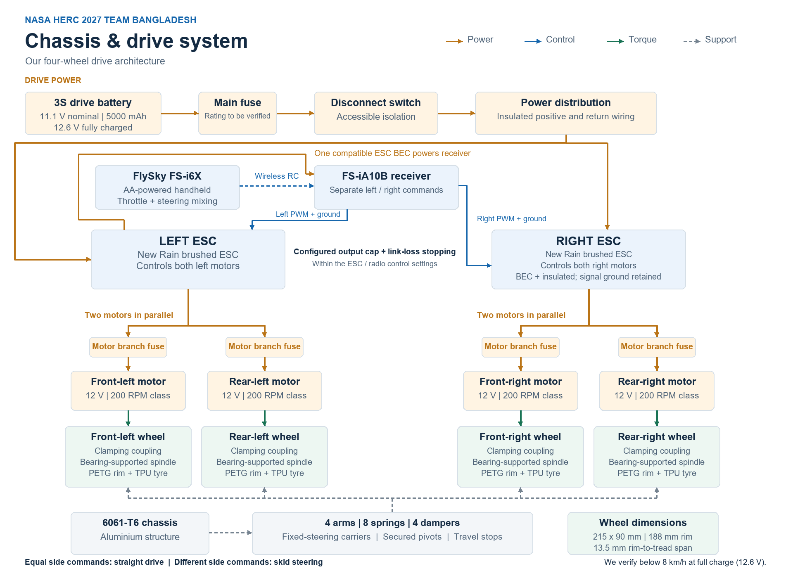
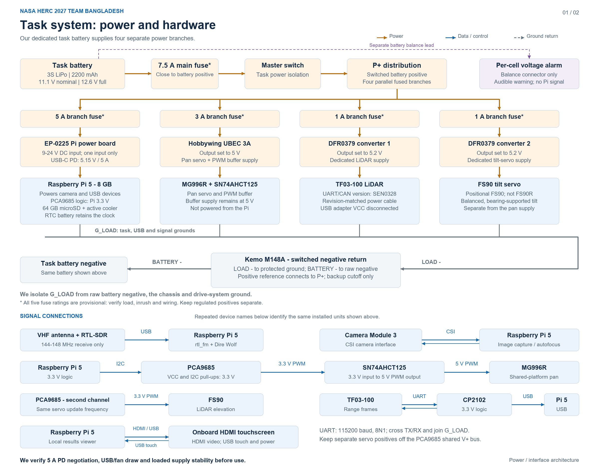
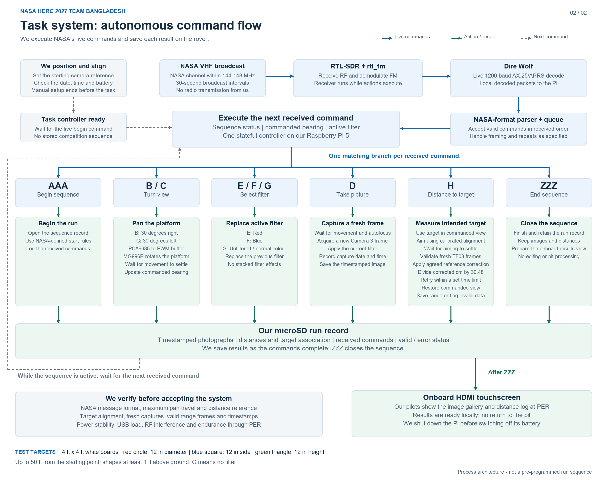

# System diagrams

These repository exports follow our current documented architecture. They are block diagrams, not complete wiring drawings or evidence of a working rover.

## Chassis and drive

We will feed the receiver from one ESC BEC after verifying its compatibility. It does not branch from raw battery power. The suspension has eight springs and four dampers. See [design baseline](../docs/design-baseline.md) for exact interfaces and pending component checks.

## Task power and hardware

The Kemo M148A switches the common negative return. All four branches disconnect together only if their return paths do not bypass it. The battery guard is backup pack protection, not an automatic orderly Pi shutdown.

## Autonomous command flow

Each received command selects one handler; the branch layout does not prescribe NASA's command sequence. The intended target means the target in the commanded view. Reference correction precedes conversion to feet. Failed ranging has a bounded retry and an explicit unavailable result.

## Editable sources

- [Chassis HTML](NASA-HERC-2027-Chassis-Block-Diagram.html)
- [Task HTML, two pages](NASA-HERC-2027-Task-Block-Diagram.html)
- [Chassis source](../tools/build_chassis_diagram.py)
- [Task source](../tools/build_task_diagram.py)

Rebuild with Python and the Pillow version in `requirements-diagrams.txt`. Arial was used for these exported images. Liberation Sans is a compatible fallback; width checks stop regeneration if replacement-font text does not fit. All sources use repository-relative paths.

The repository derivatives update stale local BEC/spring wording and the ambiguous H-card title. They do not update the separately saved Canva designs.
